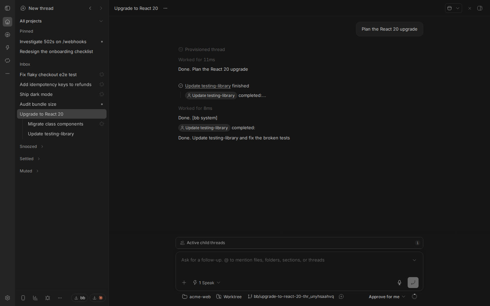
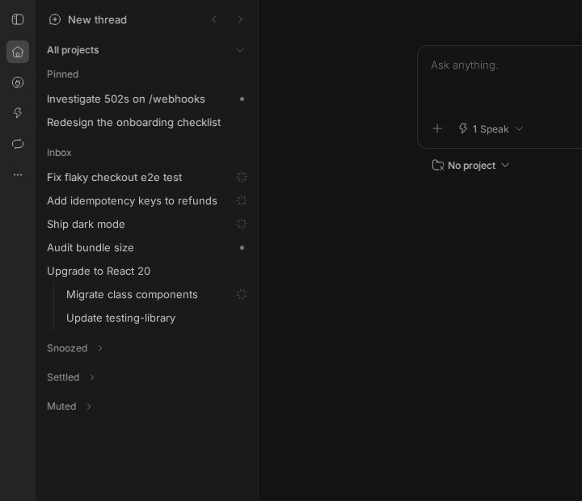
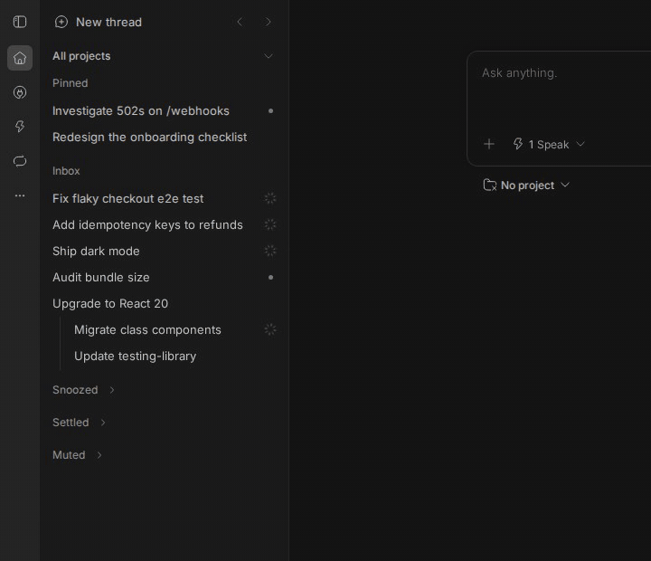
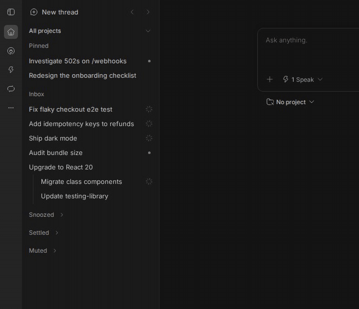
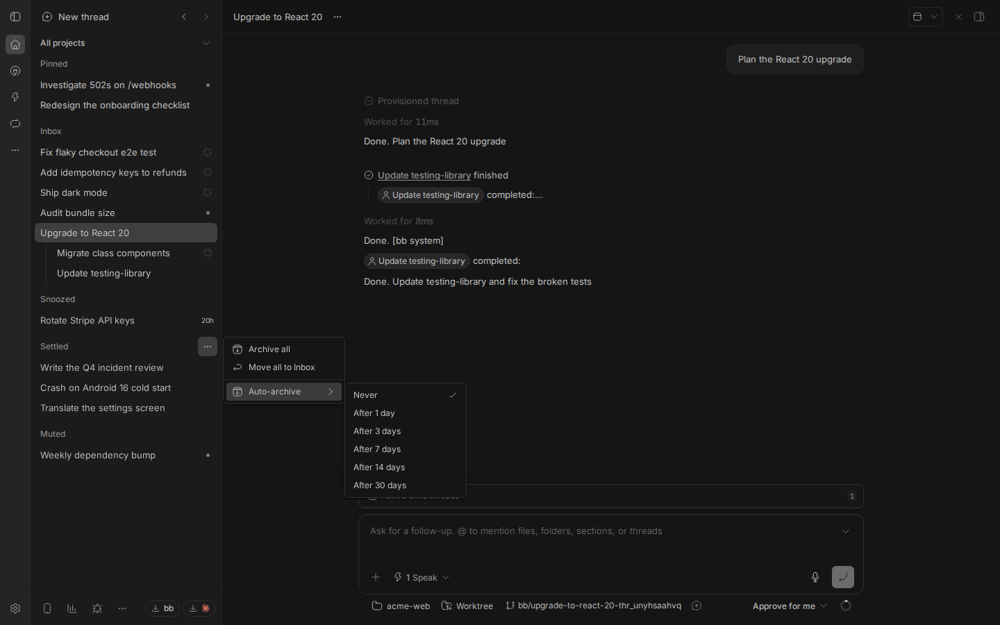

# Beside

An inbox for your bb threads. Threads stay in the order you started them, and
work you have dealt with moves to a shelf until it has news.



## Install

```sh
bb plugin install git:https://github.com/ahkohd/bb-plugin-beside.git
```

Then choose Beside in Settings, Appearance, Sidebar. bb's own list comes back
if you switch away or disable the plugin.

Beside needs bb 0.46 or later.

## How it works

The sidebar has five shelves:

- Pinned: your pinned threads, in the order you drag them into.
- Inbox: everything else, newest first. A row never moves because an agent
  finished something; its status shows at the end of the row instead.
- Snoozed: hidden until the time you picked.
- Settled: work you are done with.
- Muted: threads you never want back in the Inbox, but do not want to archive.

A snoozed or settled thread comes back to the Inbox when it finishes, fails or
asks you something. A muted thread stays muted until you unmute it; if it asks
you something, the Muted header shows bb's question glyph.

You cannot park a thread that is waiting for your answer, because hiding the
question would leave the agent stuck. A running thread can be parked.

Child threads sit under their parent and move with it. A collapsed parent shows
the most urgent status among its children.

## Everyday use

Hover a row to snooze it until tomorrow, settle it, or open bb's thread menu.



Open a parent to see its children.



Drag a pinned thread to reorder it. The order is saved in bb, so bb's own list
shows it too.



## Menus

Each shelf header has a menu, shown on hover. Bulk actions offer Undo.

| Shelf   | Menu                                         |
| ------- | -------------------------------------------- |
| Inbox   | Settle all, Snooze all, Settle after reading |
| Snoozed | Wake all                                     |
| Settled | Archive all, Move all to Inbox, Auto-archive |
| Muted   | Unmute all, Archive all                      |

Bulk actions apply to what the shelf shows, so the project filter and search
count. Threads waiting for your answer are skipped.

Settle after reading settles a thread when you move on to another thread, if
you have read it and it is idle. Moving between a parent and its children does
not count as moving on. It only applies to threads you read after switching it
on.

Auto-archive archives threads that have stayed settled for 1, 3, 7, 14 or 30
days with no news. It is set to Never by default. It runs on the bb server once
an hour and skips pinned threads and threads that are running or waiting for
you.



Mute and Unmute are in bb's thread menu. Muting also turns off the thread's
push notifications, and unmuting puts back the level it had before.

## Where your data lives

Beside keeps its state in its own database on the bb server: which threads are
snoozed, settled or muted, which shelves and parents you collapsed, and your
two settings. Nothing is added to bb's own threads. Your layout follows you to
every device, and uninstalling the plugin removes its state.

## Limits

- Beside uses bb's experimental plugin APIs, so a bb update can break it.
- It draws every row of an open shelf. Very large sidebars, in the thousands of
  threads, may feel slower than bb's own list.

## Development

```sh
npm install
npm test
npm run typecheck
npm run build
```

`npm run build` uses the pinned `bb-app` to run `bb plugin build`.

## Credits

Beside started as t3sidebar by Michael Yong, from
[SawyerHood/sawyer-plugins](https://github.com/SawyerHood/sawyer-plugins).

## Licence

MIT
