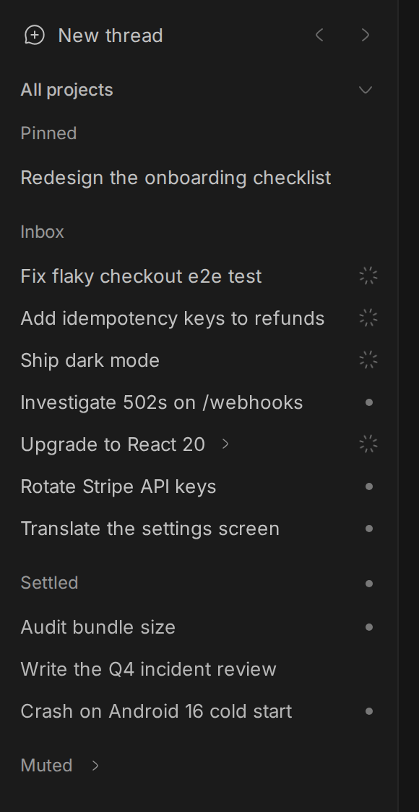
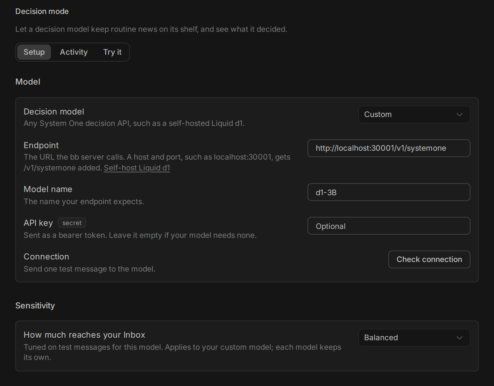
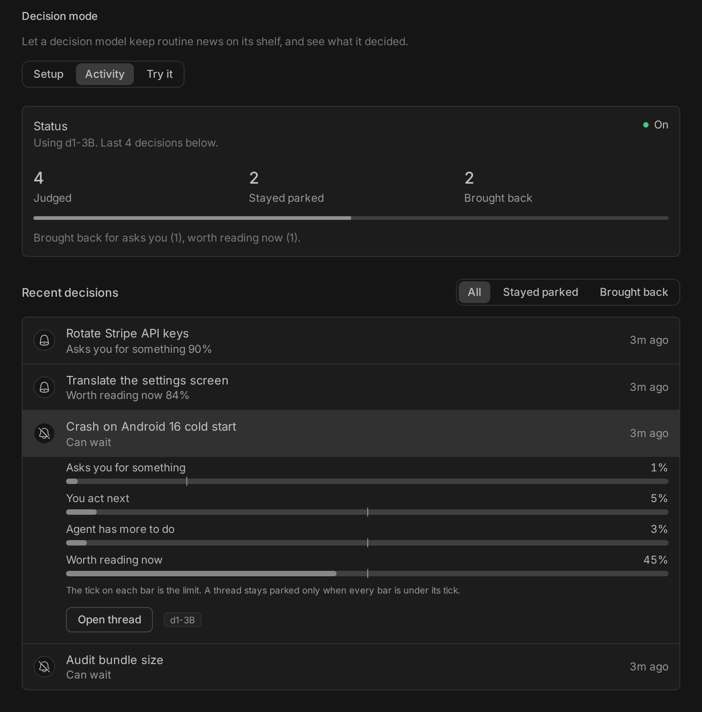
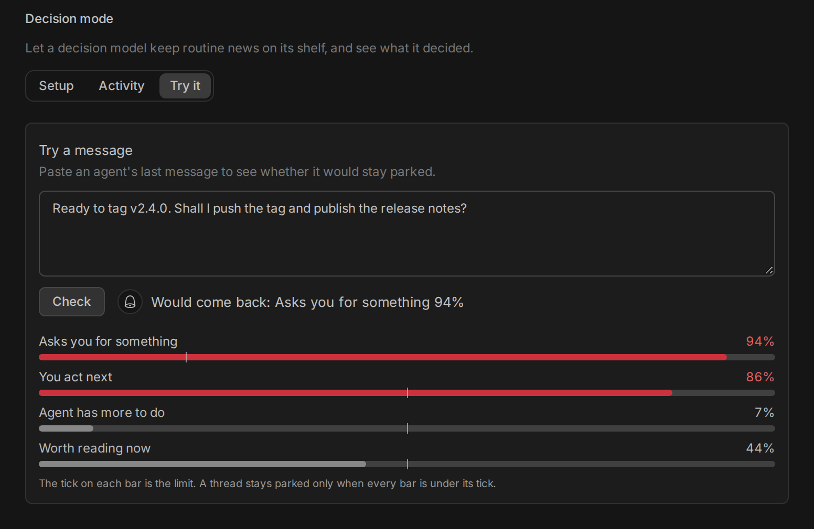

# Beside

An inbox for your bb threads. Threads stay in the order you started them, and
work you have dealt with moves to a shelf until it has news.


## Install

```sh
bb plugin install git:https://github.com/ahkohd/bb-plugin-beside.git
```

Then choose Beside in Settings, Appearance, Sidebar. bb's own list comes back
if you switch away or disable the plugin.

Beside needs bb 0.46 or later.

## How it works

The sidebar has five shelves:

- Pinned: your pinned threads, in the order you drag them into.
- Inbox: everything else, newest first. A row never moves because an agent
  finished something; its status shows at the end of the row instead.
- Snoozed: hidden until the time you picked.
- Settled: work you are done with.
- Muted: threads you never want back in the Inbox, but do not want to archive.

A snoozed or settled thread comes back to the Inbox when it finishes, fails or
asks you something. A muted thread stays muted until you unmute it; if it asks
you something, the Muted header shows bb's question glyph.

You cannot park a thread that is waiting for your answer, because hiding the
question would leave the agent stuck. A running thread can be parked.

Child threads sit under their parent and move with it. A collapsed parent shows
the most urgent status among its children.

## Everyday use

Hover a row to snooze it until tomorrow, settle it, or open bb's thread menu.


Open a parent to see its children.


Drag a pinned thread to reorder it. The order is saved in bb, so bb's own list
shows it too.


## Menus

Each shelf header has a menu, shown on hover. Bulk actions offer Undo.

| Shelf   | Menu                                         |
| ------- | -------------------------------------------- |
| Inbox   | Settle all, Snooze all, Settle after reading |
| Snoozed | Wake all                                     |
| Settled | Archive all, Move all to Inbox, Auto-archive |
| Muted   | Unmute all, Archive all                      |

Bulk actions apply to what the shelf shows, so the project filter and search
count. Threads waiting for your answer are skipped.

Settle after reading settles a thread when you move on to another thread, if
you have read it and it is idle. A background command, such as a dev server,
does not stop it. Moving between a parent and its children does
not count as moving on. It only applies to threads you read after switching it
on.

Auto-archive archives threads that have stayed settled for 1, 3, 7, 14 or 30
days with no news. It is set to Never by default. It runs on the bb server once
an hour and skips pinned threads and threads that are running or waiting for
you.


## Decision mode

Decision mode asks a decision model whether news on a snoozed or settled thread
needs you. When an agent finishes a turn on a parked thread, Beside sends the
thread's title and the agent's last message to the model. If the message only
reports routine work, the thread stays on its shelf with bb's unread dot, and
the shelf header shows a dot too.



Anything else comes back to the Inbox as before: a question, a failure, a
message that asks you something or is worth reading now, and any answer the
model is unsure about. If the model cannot be reached, times out or answers
something unexpected, the thread comes back too.

Decision mode is off by default. To turn it on, open Settings, Plugins, Beside.
Under Decision mode, Setup, choose a model:

- TypeSafe Jev: TypeSafe's hosted model. Paste your TypeSafe API key. Your
  agents' last messages are then sent to TypeSafe.
- Custom: any System One decision API, such as a self-hosted Liquid d1. Enter
  its endpoint and model name. The API key is optional.

Each model keeps its own key. Keys are stored on the bb server in a file only
the server can read, and are never sent back to the browser. Check connection
sends one test message and shows which model answered and how long it took.



### Use a self-hosted model

We recommend a self-hosted model, so your agents' messages stay on your own
machines. [Liquid d1](https://huggingface.co/LiquidAI/d1-3B-GGUF) is a 3B
decision model. llama.cpp b11485 or later serves it at `/v1/systemone`:

```sh
llama-server --model d1-3B-Q8_0.gguf --alias d1-3B --host 0.0.0.0 --port 30001
```

Choose Custom, enter `localhost:30001` (or the machine's address) and the model
name `d1-3B`, and leave the key empty. The model must be reachable from the
machine that runs the bb server.

### How much reaches your Inbox

The model rates four chances for each message: that it asks you for
something, that you act next, that the agent has more to do, and that it is
worth reading now. A thread stays parked only when every chance is under its
limit. Each model has its own limits, because models rate differently.

Choose Less, Balanced or More, or set each limit under Advanced. Before you
save, Beside shows how your recent verdicts would have changed.

The Activity tab lists recent decisions with the chances behind each one.



The Try it tab shows what the model would do with a message you paste.



Mute and Unmute are in bb's thread menu. Muting also turns off the thread's
push notifications, and unmuting puts back the level it had before.

## Where your data lives

Beside keeps its state in its own database on the bb server: which threads are
snoozed, settled or muted, which shelves and parents you collapsed, your
settings and the last 500 decision model verdicts. Nothing is added to bb's own threads. Your layout follows you to
every device, and uninstalling the plugin removes its state. Beside sends nothing
anywhere unless you set a decision model endpoint.

## Limits

- Beside uses bb's experimental plugin APIs, so a bb update can break it.
- Above 150 threads, rows far from view are drawn as simple placeholders and
  become full rows as you scroll to them, like bb's own list.

## Development

```sh
npm install
npm test
npm run typecheck
npm run build
```

`npm run build` uses the pinned `bb-app` to run `bb plugin build`.

## Credits

Beside started as t3sidebar by Michael Yong, from
[SawyerHood/sawyer-plugins](https://github.com/SawyerHood/sawyer-plugins).

## Licence

MIT
